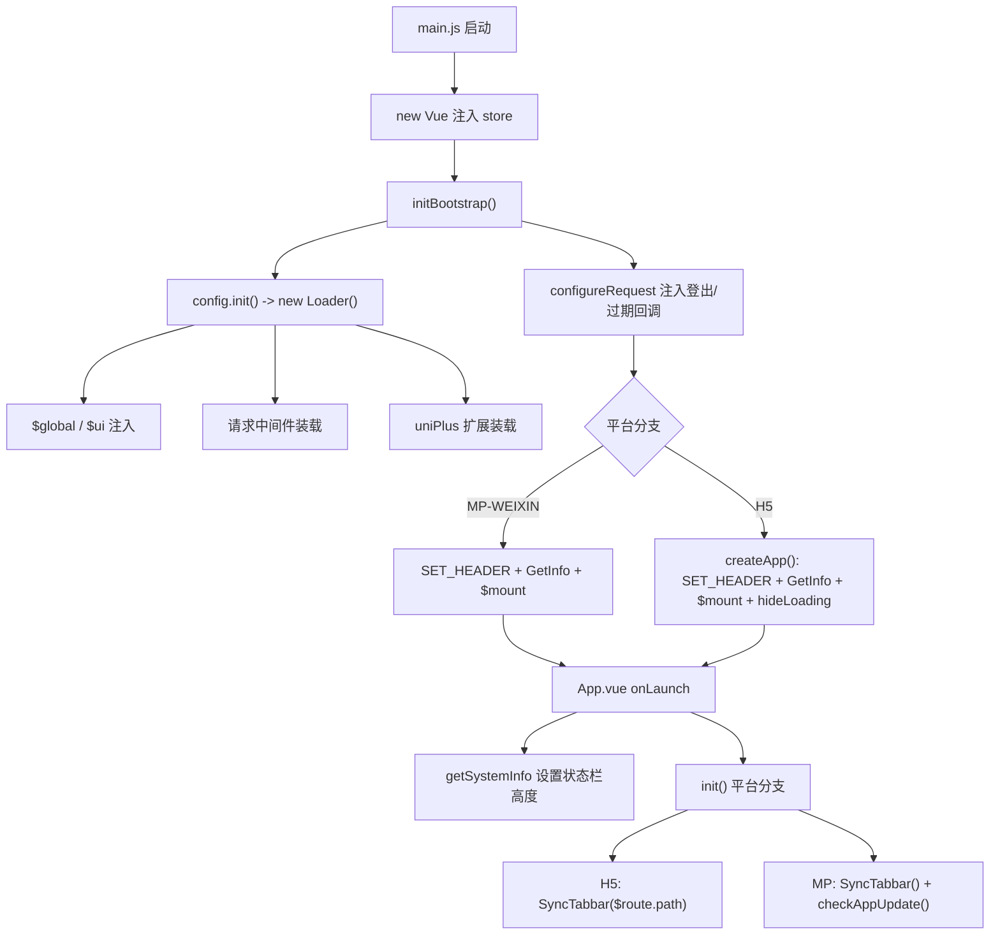
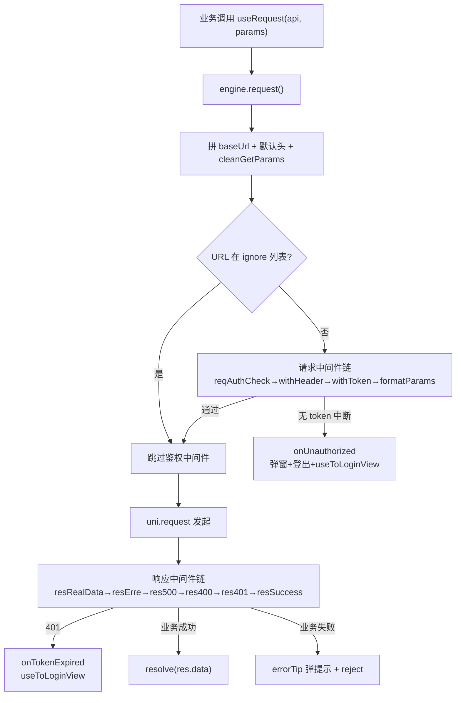
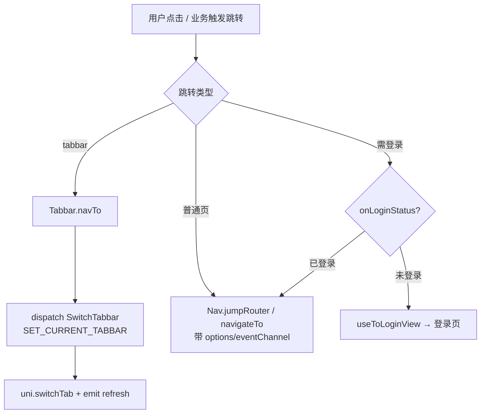
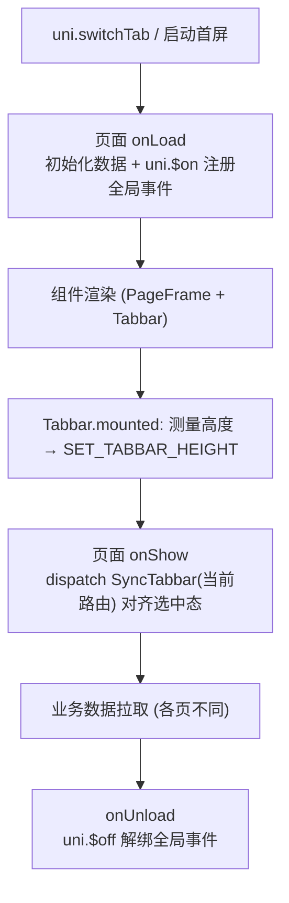
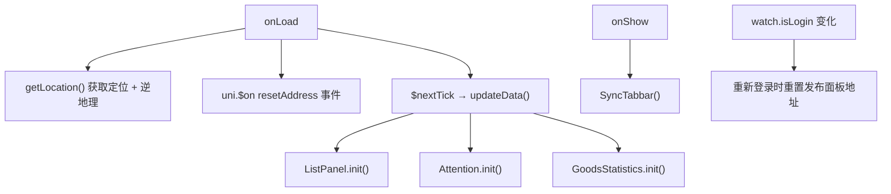
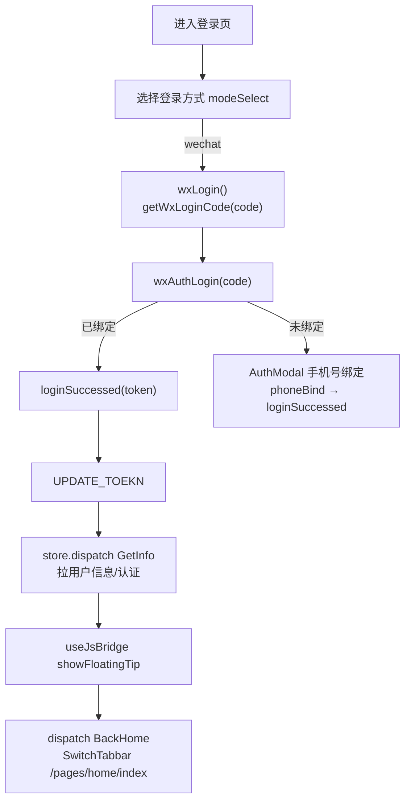
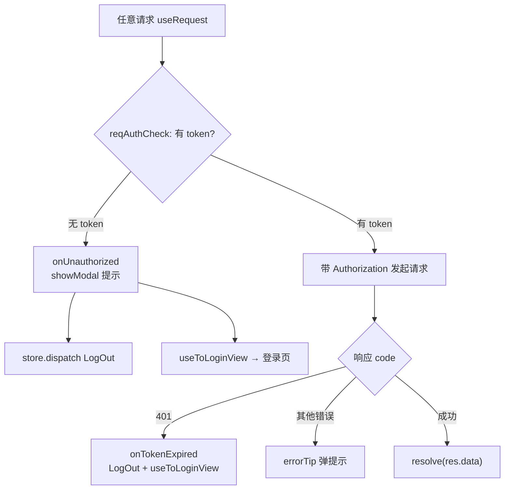

<!-- @by oh-my-zerone 2026-10-30
  页面逻辑执行顺序文档（基于当前工程实际代码扫描，非 2026-06-05 的旧 introduction）。
  覆盖：应用启动装载、请求链路、鉴权、路由导航、页面生命周期及各页面逻辑顺序。
  流程图使用 Mermaid，可在支持 Mermaid 的 Markdown 预览中渲染。 -->

# 页面逻辑执行顺序

> 适用范围：本仓库当前 `src/` 实际代码（Vue2 + UniApp，H5 / 微信小程序双端）。
> 路由以 `src/pages.json` 为准（首页= `pages/home/index`，tabbar 五页：首页 / 货源 / 运单 / 我的 / AI）。

---

## 1. 应用启动与框架装载顺序

入口为 `src/main.js`，核心职责：创建 Vue 实例 → 初始化框架 `initBootstrap()` → 按平台分支挂载 `app.$mount()`。

**关键顺序（`main.js`）**

1. H5 端先注入 `@babel/polyfill` / `es6-promise`。
2. `new Vue({ ...App, store })` 创建 `app`（注入 Vuex）。
3. 调用 `initBootstrap()`（`bootstrap.config.js`）：
   - `configureRequest({ onUnauthorized, onTokenExpired })` 向请求器注入「登出 + 跳转登录」回调（解耦 store 与请求层）。
   - `config.init()` → `new Loader(configInstance)`（`bootstrap/loader.js`）：
     - `loadProperties`：`Vue.prototype.$global = global`、`prototype.storeBridge`。
     - `loadRequest`：装载请求 baseUrl / 中间件 / 默认头 / ignore / errCodeMsg。
     - `loadUniPlusEnter`：把 `uniPlus` 扩展挂到 `uni.xxx`。
     - `loadStatic`：记录 `wxAuthorization`。
     - `loadUi`：`Vue.prototype.$ui = ui`（品牌配置）。
     - `loadComponents`：全局注册组件（当前为空）。
4. 平台分支（条件编译）：

| 分支 | 动作 | 文件 |
| --- | --- | --- |
| `MP-WEIXIN` | `store.commit('SET_HEADER', Loader.defaultHeader)` → `useDefineConfig(...)` → 有 token 则 `GetInfo` 后 `app.$mount()`，否则直接 mount | `main.js` |
| `H5` | `createApp(app)` → 提交 header / `useDefineConfig` → 有 token 则 `GetInfo().finally(mount)` 否则直接 mount → 关闭原生 loading（`hideLoadingView`） | `bootstrap/Bridge/createApp.js` |

**App.vue（`onLaunch`）**

- `uni.getSystemInfo` → 设状态栏高度到 CSS 变量 `--status-bar-height-custom` / storage / `store.dispatch('SetSystemInfo')`。
- `init()`：
  - H5：`initH5()` → 登录态则 `showFloatingTip`；`SyncTabbar($route.path)`（以当前路由对齐 tabbar，不跳转）。
  - 小程序：`initWX()` → `SyncTabbar()`（兜底，页面栈未就绪时安全跳过）+ `checkAppUpdate()`（小程序版本检测，幂等）。

---

## 2. 请求链路执行顺序

请求层已拆分为「组合根 + 纯引擎 + 中间件」三层（`src/common/request/`）。

**调用栈**

`useRequest / request(options)` → `engine.request()`（`core/engine.js`）：
1. 解析 `baseUrl` + 默认头，拼 `realUrl`；GET 走 `cleanGetParams` 剔除 `null/undefined` 参数。
2. 若与前一次同 URL 未完成请求，先 `abort()`。
3. 若 URL 不在 `ignore` 列表，跑 **请求中间件链** `runRequestChain`（`reqAuthCheck → reqWithHeader → reqWithToken → reqFormatParams`）：
   - `reqAuthCheck`：无 token 时调用 `meta.hooks.onUnauthorized`（弹窗 + 登出 + 跳转登录），并中断链路。
   - `reqWithToken`：注入 `Authorization` 头。
4. 按需 `uni.showLoading`。
5. `uni.request` 发起请求。
6. 成功响应走 **响应中间件链** `runResponseChain`（`resRealData → resErre → res500 → res400 → res401 → resSuccess`）：
   - `resRealData`：提取 `res.data` 作为业务结果。
   - `res401`：触发 `meta.hooks.onTokenExpired`（跳转登录，静默不弹）。
   - 失败链：调用 `errorTip` 弹 toast/modal 后 `reject`。

---

## 3. 全局状态与鉴权

- **Vuex**（`store/index.js` 自动注册 `modules/*`）：`header`、`user`、`tabbar`。
- **登录态**：token 经 `auth.js` → `platform/storage`（H5 同步写原生 `dataStore`）。
- **用户信息**：`user.GetInfo`（拉 `ApiGetUserInfo` → 提交 `SET_USERINFO` → `GetUserStatus` 拉货主认证）→ 决定 `isAuth`、`shipmentInfo`。
- **tabbar 选中态**：`tabbar.SyncTabbar(route)`（只同步状态、不跳转）与 `SwitchTabbar(route)`（同步状态 + `uni.switchTab` + 触发对应页 refresh 事件）。

---

## 4. 路由导航与页面跳转逻辑

| 能力 | 实现 | 说明 |
| --- | --- | --- |
| tabbar 切换 | `Tabbar.vue` 的 `navTo` → `store.dispatch('SwitchTabbar', path)` | 先 `SET_CURRENT_TABBAR`，再 `uni.switchTab`，最后 `uni.$emit(tabbar.refresh)` 刷新目标页 |
| 普通跳转 | `uni.navigateTo` / `Nav.jumpRouter` | 进入非 tabbar 页面，携带 `options` 或 `eventChannel` |
| 返回 | `Nav.back` / `usePlusNavigateBack` | 原生环境走桥 `finish`/`navigate.back`，否则 `navigateBack` |
| 去登录页 | `useToLoginView()` → `uni.navigateTo('/pages_login/login/index')` | 由请求 401 / 无 token / `onLoginStatus()` 触发 |
| 登录前置校验 | `onLoginStatus()` / `onAuthorization(url, payload)` | 未登录弹窗引导登录；已登录带参数跳转 |

---

## 5. 页面生命周期通用执行顺序

所有页面均在 `uni-app` 框架路由驱动下实例化。tabbar 页与详情页模式不同：

### 5.1 tabbar 页通用顺序

- **`onLoad`**：页面初始化、注册 `uni.$on('<page>:refresh' 等)` 全局刷新/通知事件。
- **`onShow`**：必做 `this.$store.dispatch('SyncTabbar')` 对齐 tabbar 选中态（覆盖服务号直达、返回等非点击进入场景）。
- **`onUnload`**：`uni.$off` 解绑，防止重复注册与内存泄漏。

### 5.2 非 tabbar 详情页顺序

- **`onLoad(options)`**：取 `options` 参数（如 `code`）→ 触发详情请求。
- **`mounted`**：端差异初始化（小程序按胶囊实测导航栏高度；H5 动态加载高德 SDK `initAMap`）。
- **`onUnload` / `beforeDestroy`**：清理地图实例、定时器。

---

## 6. 各页面逻辑执行顺序明细

### 6.1 首页 `pages/home/index`

- 默认首屏页，启动即进入。
- 发布成功跨层通知：`uni.$emit('pages/home/index:resetAddress')` → `onLoad` 中 `uni.$on` 订阅（规避 `eventChannel` 仅单层限制）。

### 6.2 货源 `pages/goods/index`

- `onLoad`：`refreshPage()`（`fetchPriceModels()` + `handleSearch()`）+ 注册 `:refresh` / `:showIncrementModal` / `:showQr` 事件。
- `onShow`：`SyncTabbar()`。
- `onUnload`：解绑三事件。
- 列表请求 `getList()`：先 `uni.isLogin()` 守卫；`useRequest(ApiGetSourceList)`；支持筛选 / 分页 / 下拉刷新 / 触底加载。
- 货源码弹窗：`getCym` 接口取 base64 → 小程序落地为临时文件后渲染。

### 6.3 运单 `pages/waybill/index`

- `onLoad`：`refreshPage()`（未登录则 `reset()` 直接返回）+ 注册 `:refresh`。
- `onShow`：`SyncTabbar()`。
- `onUnload`：解绑。
- `getList()`：登录 + `isAuth` 双重守卫；运输/结算 tab 与状态 tab 切换均触发 `handleSearch()`。

### 6.4 我的 `pages/user/index`

- `onShow`（**无 onLoad 数据请求**）：
  1. `SyncTabbar()`。
  2. `isLogin = uni.isLogin()`；未登录直接返回（仅展示静态信息）。
  3. 已登录：`store.dispatch('GetInfo')` → 并行 `fetchAccountInfo()` + `fetchQuickMenu()`。
- 下拉刷新 `onRefresh`：重复上述已登录流程。
- 数据来源：`useUserCenter` hook 的模块级 observable state（账户、便捷菜单）。

### 6.5 AI `pages/ai/index`

- 占位骨架页（`PageFrame` + 文案），仅 `showTabbar`，无业务请求。
- `onShow` 由 `PageFrame`/`Tabbar` 上下文统一走 `SyncTabbar`（该页未自定义，但作为 tabbar 页进入时由 `App.vue`/`Tabbar` 兜底对齐）。

### 6.6 运单详情 `pages/waybill/waybillDetails/index`

- `onLoad(options)`：`detailsInfo = { code: options.code }` → `getDetailsInfo()`（`ApiGetWaybillDetail` → `waybillDetailView` 映射 → 详情落地）。
- `mounted`：小程序实测导航栏高度；H5 `initAMap()` 加载高德。
- 详情落地后 `$nextTick` → `loadDrivingRoute()`（高德驾车规划）→ 绘制 marker/polyline。
- 底部操作：`eventCall(event)` 分发 补凭证 / 联系司机 / 核算 / 申请打款 / 付款 / 作废 等，均 `navigateTo` 子页并监听 `acceptDataFromOpenerPageBack` 回调刷新本页 + `uni.$emit('pages/waybill/index:refresh')` 刷新列表页。

### 6.7 登录 `pages_login/login/index`

---

## 7. 登录与鉴权拦截总流程

---

## 8. 关键文件索引

| 主题 | 文件 |
| --- | --- |
| 入口装载 | `src/main.js`、`src/bootstrap.config.js`、`src/bootstrap/bootstrap.js`、`src/bootstrap/loader.js` |
| 平台桥接（H5） | `src/bootstrap/Bridge/createApp.js`、`src/bootstrap/Bridge/*` |
| 应用生命周期 | `src/App.vue` |
| 请求核心 | `src/common/request/http.js`、`core/engine.js`、`middleware/request/*`、`middleware/response/*` |
| 存储/鉴权 | `src/common/utils/auth.js`、`src/common/platform/storage.js`、`src/common/platform/navigate.js` |
| 状态 | `src/store/index.js`、`modules/{user,tabbar,header}.js`、`src/store/tabbarList.js` |
| 路由声明 | `src/pages.json` |
| 页面外壳 | `src/pages/components/PageFrame/{index,Tabbar,Header,HeaderBg}.vue` |
| 主包页 | `src/pages/{home,goods,waybill,user,ai}/*` |
| 详情/子页 | `src/pages/waybill/waybillDetails/index.vue` |
| 登录分包 | `src/pages_login/login/index.vue` 及 `wxLogin.js`、`components/*` |

> 说明：本仓库 `introduction.md`（2026-06-05 扫描）记录的是早期页面结构（`task/order/inTransitMonitor/message`），当前 `pages.json` 已演进为 `home/goods/waybill/user/ai` + 多个分包（`pages_auth`、`pages_user` 等）。本文档以 **当前代码** 为准。
